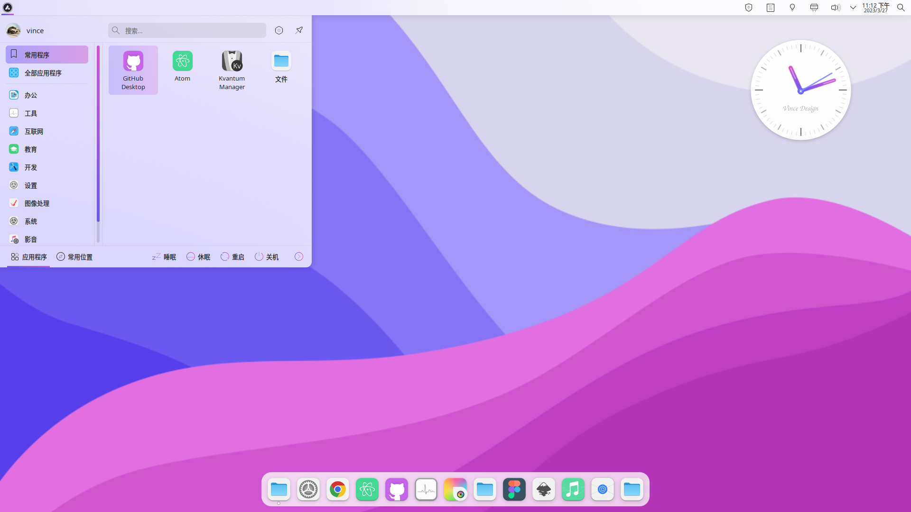
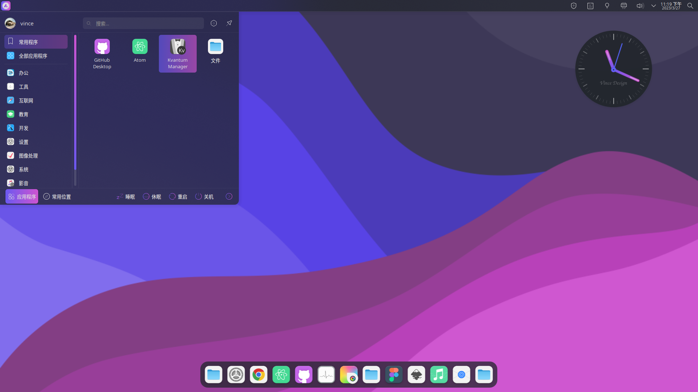

## Lavanda KDE Theme

Lavanda kde theme is a clean and concise theme for KDE Plasma 6 desktop.

Requires Plasma 6.1+ (Qt 6.5+). Tested with Plasma 6.8.2, Qt 6.11.2 and SDDM 0.21.

In this repository you'll find:

- Aurorae Theme
- Kvantum Theme
- Wallpaper Theme
- Plasma Color Scheme
- Plasma Desktop Theme
- Plasma Global Theme
- SDDM Theme (with zh_CN localization)
- Optional white logout screen override (user-level)

## Installation

User-level (no sudo):

```sh
./install.sh
```

System-wide (required for the SDDM greeter, which runs as the `sddm` user and only sees `/usr/share`):

```sh
sudo ./install.sh
```

The installer prompts whether to install the SDDM theme (requires root). To install the SDDM theme manually:

```sh
sudo ./sddm/6.0/install.sh
```

### Window decoration (Aurorae)

- Slim 22px title bar; window buttons fill the full title-bar height.
- macOS-style traffic-light buttons (kept on the right side): close = red, minimize = yellow, maximize/restore = green. Symbols appear on hover; inactive windows show gray dots.
- Rounded window corners: 10px at the top, 4px at the bottom. Maximized windows have no rounded corners (expected Aurorae behavior).
- The `mask-*` elements in `decoration.svg` define the blur region (via `KDecoration3::setBlurRegion`), not the window outline; the corner shape comes from the `decoration-*` elements.

### Plasma 6.8 compatibility

- Desktop themes use `metadata.json` + `plasmarc`; `[Wallpaper]`, `[AdaptiveTransparency]` and `[ContrastEffect]` are read from `plasmarc`.
- `opaque/` assets are provided for Plasma 6.8's opaque panel/dialog/tooltip rendering; `solid/` is kept for compatibility.
- Global themes set wallpaper and splash via `contents/defaults` (`[Wallpaper]`, `[ksplashrc]`).
- SDDM QML targets SDDM 0.21 / Qt 6 and uses `Keyboards.KWinVirtualKeyboard`.

### SDDM Localization

The SDDM theme includes zh_CN translations. On zh_CN systems, the install script automatically configures SDDM locale by adding `LANG=zh_CN.UTF-8` to `/etc/sysconfig/sddm`.

The installer does **not** restart SDDM. Restart it manually when you want to apply locale or theme changes:

```sh
sudo systemctl restart sddm
```

SDDM 0.21 may log `KLocalizedString: Domain is not set` and fall back to English for theme strings; this is a greeter translation-domain limitation, not a QML error.

### White Logout Screen (optional, user-level)

Plasma 6.x loads its logout/shutdown UI from the `org.kde.plasma.desktop` shell,
not from the theme's Look-and-Feel `contents/logout` file. The optional
`logout-white` helper installs a per-user copy of that shell with a white
translucent background and dark text:

```sh
./logout-white/install.sh
./logout-white/uninstall.sh
```

- No sudo, no system files, no KDE global configuration changes.
- Installs only under `~/.local/share/plasma/shells/org.kde.plasma.desktop`.
- Re-run the installer after Plasma updates; uninstall restores the system shell.
- Tested with Plasma 6.8.2. The background is a 65%-opaque white overlay;
  compositor blur is not added.

The main installer also offers this option when run as a regular user.

## Uninstall

```sh
./uninstall.sh        # user-level
sudo ./uninstall.sh   # system-wide
```

## Recommendations

- For better looking please use this pack with [Kvantum engine](https://github.com/tsujan/Kvantum/blob/master/Kvantum/INSTALL.md#distributions).

  Run `kvantummanager` to choose and apply **Lavanda** (or any other Lavanda) theme.

- Install [Colloid icon theme](https://github.com/vinceliuice/Colloid-icon-theme) for a more consistent and beautiful experience.

- Install [Lavanda gtk theme](https://github.com/vinceliuice/Lavanda-gtk-theme) for a more consistent and beautiful experience.

## License

GNU GPL v3

## Preview





